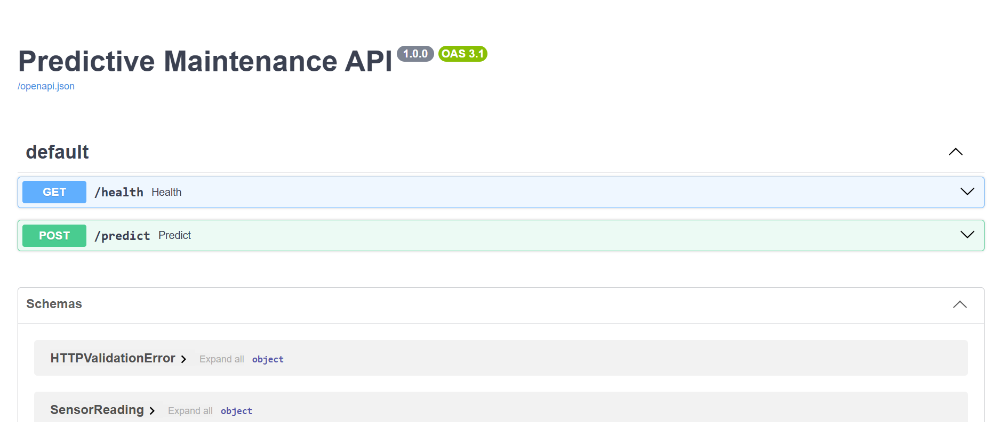
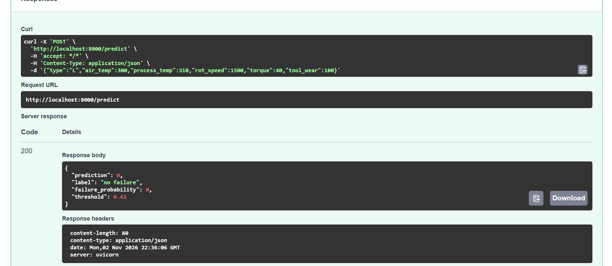
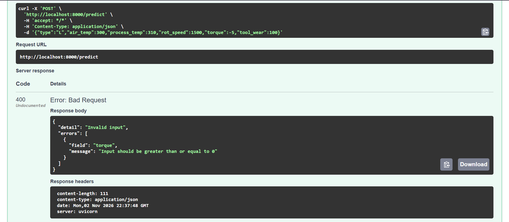

# Predictive Maintenance API (FastAPI + Docker)

A containerized REST API that serves the Random Forest model from Task 9 (AI4I 2020 predictive maintenance). It receives raw sensor readings and returns a failure prediction.

Part of the Elevvo Machine Learning Internship (Task 10).

## Features
- **FastAPI** service with interactive docs at `/docs`.
- **Input validation with Pydantic**: wrong types, out-of-range values, unknown fields, missing fields or invalid JSON return **400 Bad Request** with a message naming the faulty field (FastAPI's default 422 is overridden).
- **Same feature engineering as training**: `temp_diff`, `power` and `wear_torque` are computed inside the API from the raw sensors.
- **Tuned decision threshold (0.43)** stored with the model, chosen in Task 9 to keep false alarms low.
- **Docker** image with pinned `scikit-learn==1.6.1`, the version the model was trained with.

## Run
```bash
docker build -t predictive-maintenance-api .
docker run -p 8000:8000 predictive-maintenance-api
```
Then open http://localhost:8000/docs

## Endpoints
| Method | Path | Description |
|---|---|---|
| GET | `/health` | Service status and decision threshold |
| POST | `/predict` | Predict failure from sensor readings |

### Example request
```json
{"type": "L", "air_temp": 300, "process_temp": 310, "rot_speed": 1500, "torque": 40, "tool_wear": 100}
```
The response contains `prediction` (0/1), `label`, `failure_probability` and `threshold`.

### Validation
| Input | Result |
|---|---|
| Valid reading | 200 |
| Text in a numeric field (`"torque": "abc"`) | 400 |
| Out-of-range value (`"torque": -5`) | 400 |
| Invalid `type` (not L, M or H) | 400 |
| Missing field | 400 |

## Project structure
app/
main.py # FastAPI service
model/predictive_maintenance_model.pkl # model + threshold + feature order
Dockerfile
requirements.txt

## Tools
Python, FastAPI, Pydantic, Uvicorn, scikit-learn, Docker.

## Screenshots

**API documentation (Swagger UI)**



**Valid request: 200 OK with the prediction**



**Invalid request (negative torque): 400 Bad Request with the faulty field**


